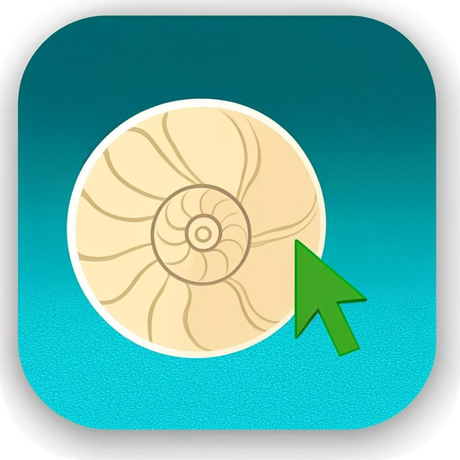

<div align="center">



# 🐚 SeaShell

**SSH-клиент для Android**

Kotlin · minSdk 24 (Android 7.0) · JSch + xterm.js

</div>

---

## Возможности

- 🖥 **Интерактивный терминал** — полноценная эмуляция xterm-256color (цвета, курсор, скроллбек 5000 строк) на базе xterm.js
- 💾 **Список серверов** — сохранение подключений (хост, порт, пользователь, способ входа), редактирование, дублирование, удаление
- 🔑 **Аутентификация** — по паролю или приватным ключом (OpenSSH / PEM), с passphrase; поддержка keyboard-interactive (PAM)
- 💬 **Диалоги входа** — если пароль не сохранён, он запрашивается при подключении; понятные сообщения об ошибках (таймаут, неверный пароль, отклонённое соединение)
- ⚡ **Быстрое подключение** — введите просто `user@host:port` без сохранения: приложение спросит логин и пароль вручную, а после успешного входа предложит сохранить сервер в список
- 🔄 **Обновление внутри приложения** — SeaShell проверяет новые релизы на GitHub (автоматически раз в 8 часов и вручную в «Настройках»), скачивает APK и запускает установку
- 🛡 **Проверка ключей хостов** — диалог подтверждения отпечатка при первом подключении и запоминание ключа (known hosts)
- 🎨 **6 тем оформления** — Океан, Графит, Закат, Лес, Аметист, Роза (светлые и тёмные варианты)
- 🌍 **6 языков** — русский, English, français, 中文, العربية (RTL), español; переключение внутри приложения
- ✍️ **Удобства терминала** — панель доп. клавиш (ESC, TAB, CTRL, ALT, стрелки, HOME, END, PGUP, PGDN): Ctrl и Alt — с залипанием и блокировкой долгим нажатием, работают с любыми кнопками; вставка из буфера обмена, изменение размера шрифта, экран не гаснет во время сессии
- 📶 **Связь не рвётся** — во время сессии работает foreground-сервис с wake-lock: CPU и Wi‑Fi не засыпают при выключенном экране, keep-alive продолжает идти
- 🔁 **Авто-переподключение** — если связь всё же прервалась (сбой Wi‑Fi, сон сети, перезапуск сервера), SeaShell сам восстанавливает сессию в фоне за несколько попыток и сообщает тостом «Соединение восстановлено»; экран «Соединение закрыто» появляется только если все попытки не удались
- 🔋 **Исключение из оптимизации батареи** — при первом подключении приложение предложит отключить doze-ограничения, чтобы фоновое удержание и восстановление связи работали надёжно
- 🤖 **Поддержка Android 7.0+** (API 24), адаптивная иконка и monochrome-слой для Android 13+

## Установка

Скачайте готовый `SeaShell-1.6.0.apk` из раздела [Releases](https://github.com/teliy/SeaShell/releases) и установите его
(при необходимости разрешите установку из неизвестных источников).

Дальнейшие обновления можно ставить прямо из приложения: **Настройки → Проверить обновления**.

## Сборка из исходников

```bash
git clone https://github.com/teliy/SeaShell.git
cd SeaShell
./gradlew assembleRelease
# APK: app/build/outputs/apk/release/app-release.apk
```

Требуется JDK 17+ и Android SDK (platform 34). Также работает кнопка **Code → Actions → build** —
GitHub Actions соберёт APK автоматически.

## Сборка терминала

Терминал — это WebView + [xterm.js](https://xtermjs.org/) (файлы уже лежат в `app/src/main/assets/term/`),
обмен данными идёт с JSch (`com.github.mwiede:jsch`) через `JavascriptInterface`.
Реализовано: PTY, изменение размера окна (window-change), UTF-8, keep-alive каждые 30 секунд.

## Примечания по безопасности

- Приватные ключи не копируются в хранилище приложения — читаются напрямую из выбранного файла (SAF).
- Пароли и known hosts хранятся в приватном хранилище приложения (SharedPreferences, доступно только SeaShell).
  В планах — миграция на EncryptedSharedPreferences.
- Поддерживаются ключи OpenSSH и PEM; формат `.ppk` пока не поддерживается.

## Структура

```
app/src/main/java/com/teliy/seashell/
├── MainActivity.kt            # список серверов
├── SessionEditorActivity.kt   # редактор подключения
├── TerminalActivity.kt        # SSH-терминал (JSch + xterm.js)
├── SettingsActivity.kt        # темы, язык, known hosts
├── KnownHostsRepository.kt    # хранилище ключей хостов
├── ShellUserInfo.kt           # диалоги (пароль, passphrase, host key, keyboard-interactive)
├── UpdateManager.kt           # обновление внутри приложения (GitHub Releases)
├── SessionStore.kt            # сохранение подключений
├── ThemeManager.kt            # 6 тем оформления
└── ...
```

## Лицензия

Проект распространяется под лицензией [GNU GPL v3](LICENSE) © 2026 teliy.

Это значит:

- вы можете свободно использовать, изучать и изменять код;
- производные приложения обязаны оставаться открытыми под той же лицензией;
- автор сохраняет за собой право выпускать коммерческие версии по отдельной лицензии
  (dual licensing) — обращайтесь через Issues.

---

<div align="center">

### English summary

SeaShell is an open-source SSH client for Android 7.0+: saved server list, quick connect without saving,
interactive xterm-256color terminal (xterm.js + JSch), password/key auth, host key verification,
an extra keys bar (ESC, TAB, sticky/latchable Ctrl and Alt, arrows, HOME, END, PGUP, PGDN),
a foreground service with wake locks that keeps the link alive with the screen off, transparent
auto-reconnect when the link drops, a one-time battery optimization exemption prompt,
6 color themes and 6 languages (ru/en/fr/zh/ar/es with RTL), font size control and clipboard paste.
Licensed under the GNU GPL v3.

</div>
